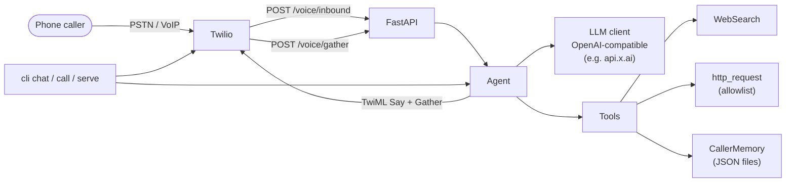

# Charlie-Agent

**A phone-first AI agent showcase** — answer inbound calls, place outbound calls, and take external actions (web search, HTTP requests, tool calls) in a single agent loop.

> **Not affiliated with xAI.** Charlie-Agent is an independent open-source project inspired by publicly documented Grok / Grok Bot capabilities. It is not a product of xAI, does not use proprietary Grok Bot internals, and is not endorsed by xAI.

Built as a clean architecture demo for [sravan2828](https://github.com/sravan2828): minimal, runnable, well-commented Python that shows how a telephony agent harness fits together — not a production voice stack.

---

## Vision

Charlie is the kind of agent you can **call on the phone** (or that can call you), hold a multi-turn conversation, remember facts about the caller, and reach out to the outside world via tools — the same high-level shape as modern Grok bots, but open, inspectable, and owned by you.

Core capabilities in this repo:

1. **Inbound voice** — Twilio webhook answers the call, gathers speech, runs the agent, speaks back.
2. **Outbound voice** — place a call via Twilio REST; the callee lands in the same gather loop.
3. **Tool calling** — web search + allowlisted HTTP + per-caller memory write.
4. **Text REPL** — exercise the agent loop without a phone (`python -m charlie.cli chat`).

---

## Architecture



**Turn-taking today:** Twilio `<Gather input="speech">` → agent → `<Say>`.  
**Production path (roadmap):** Twilio Media Streams (WebSocket) + realtime STT/TTS (or the [Grok Voice Agent API](https://x.ai/api/voice)) for full-duplex, barge-in, sub-second latency.

---

## Design inspiration: Grok capabilities

Research snapshot as of **November 2026**, drawn only from public xAI documentation and product pages. Charlie-Agent mirrors the *ideas*; it does not reimplement proprietary Grok systems.

| Grok capability | What public docs say | Source | Charlie-Agent mapping |
| --- | --- | --- | --- |
| **Voice / speech-to-speech** | Realtime full-duplex voice agents with sub-second latency, tool use mid-conversation, interruption/barge-in; also TTS + STT APIs | [x.ai/api/voice](https://x.ai/api/voice), [Voice overview](https://docs.x.ai/developers/model-capabilities/audio/voice) | **Stubbed / demo** — Twilio Gather+Say turn-taking. Realtime Media Streams + Grok Voice on the roadmap. |
| **Realtime conversation** | WebSocket realtime endpoint (`/v1/realtime`), session control for instructions/tools/voice | [x.ai/api/voice](https://x.ai/api/voice), [Grok Voice Agent API announcement](https://x.ai/news/grok-voice-agent-api) | **Roadmap** — this repo uses request/response TwiML, not the Realtime API. |
| **Tool use / function calling** | Custom functions (JSON Schema) + server-side built-ins; model requests a call, you execute, return results; parallel calls supported | [Tools overview](https://docs.x.ai/developers/tools/overview), [Function calling](https://docs.x.ai/developers/tools/function-calling) | **Implemented** — OpenAI-style tool schemas + dispatch loop in `charlie/agent.py`. |
| **Web search** | Built-in server-side `web_search` tool on the xAI API | [Tools overview](https://docs.x.ai/developers/tools/overview) | **Stubbed (default)** — labelled stub results; optional DuckDuckGo Instant Answer via `SEARCH_BACKEND=duckduckgo`. |
| **X search** | Built-in server-side `x_search` over posts/users/threads | [Tools overview](https://docs.x.ai/developers/tools/overview) | **Roadmap** — not wired; would be another tool schema. |
| **Image understanding** | Image input (`input_image` / URL or base64) alongside text; jpg/png, ≤20 MiB | [Image understanding](https://docs.x.ai/developers/model-capabilities/images/understanding) | **Roadmap** — text-only agent loop today. |
| **Memory** | Grok Bot remembers facts across chats for a personal bot; Responses API can store stateful conversations ~30 days | [Grok Bot chat docs](https://docs.x.ai/grok-bot/chat-and-collaboration), [Generate text / Responses](https://docs.x.ai/developers/model-capabilities/text/generate-text), [Grok Bot changelog](https://x.ai/changelog/bot) | **Implemented (simple)** — per-caller JSON files in `data/memory/` + `remember` tool. |
| **Multi-turn context** | Mix roles freely; continue via `previous_response_id` or local history | [Models](https://docs.x.ai/developers/models), [Generate text](https://docs.x.ai/developers/model-capabilities/text/generate-text) | **Implemented** — in-process message list per call / CLI session. |
| **Long context** | Grok 4.7 context window up to **500k** tokens (knowledge cutoff May 2026) | [Models](https://docs.x.ai/developers/models), [Grok 4.7 guide](https://docs.x.ai/developers/grok-4-7) | **Inherited** — whatever the configured model supports; no local compaction yet (**roadmap**). |
| **Reasoning** | Configurable reasoning levels on Grok 4.7; encrypted reasoning content on Responses API | [Grok 4.7 guide](https://docs.x.ai/developers/grok-4-7) | **Roadmap** — Chat Completions client today; Responses API + reasoning not wired. |
| **Code execution** | Built-in sandboxed `code_interpreter` / `code_execution` tool | [Tools overview](https://docs.x.ai/developers/tools/overview) | **Roadmap** — not included (intentionally out of scope for a phone showcase). |
| **Grok Bot voice chat** | Live spoken conversation with a bot on desktop/mobile; mute, transcript, continues work after hangup; draws on earlier calls/memory | [Message and collaborate](https://docs.x.ai/grok-bot/chat-and-collaboration), [Changelog](https://x.ai/changelog/bot) | **Mirrored in spirit** — phone gather loop + JSON memory; no native Grok Bot desktop integration. |

---

## Project layout

```
Charlie-Agent/
├── README.md
├── LICENSE                 # MIT © Sravan Kumar
├── requirements.txt
├── .env.example            # placeholders only
├── .gitignore
├── charlie/
│   ├── __init__.py
│   ├── __main__.py
│   ├── cli.py              # serve | call | chat
│   ├── config.py           # pydantic-settings
│   ├── llm.py              # OpenAI-compatible httpx client
│   ├── agent.py            # core tool-calling loop
│   ├── memory.py           # per-caller JSON memory
│   ├── tools/
│   │   ├── registry.py     # schemas + dispatch
│   │   ├── web_search.py   # stub | duckduckgo
│   │   └── http_request.py # allowlisted HTTP
│   └── telephony/
│       ├── twilio_server.py
│       └── outbound.py
├── data/memory/            # runtime memory (gitignored contents)
└── tests/                  # pytest, no network/credentials required
```

---

## Quickstart

```bash
python3.11 -m venv .venv
source .venv/bin/activate
pip install -r requirements.txt

# Optional: configure LLM / Twilio
cp .env.example .env
# edit .env — set XAI_API_KEY to talk to api.x.ai (or any compatible base URL)

# Text REPL (works without a key; prints a clear offline message)
python -m charlie.cli chat

# Run Twilio webhooks (pair with ngrok / cloudflare tunnel)
python -m charlie.cli serve --port 8000

# Place an outbound call (needs real Twilio creds + PUBLIC_BASE_URL)
python -m charlie.cli call +15555550123

# Tests (offline)
pytest -q
```

Point Twilio's voice webhook to `https://<your-tunnel>/voice/inbound` (POST).

---

## Environment variables

| Variable | Purpose | Default |
| --- | --- | --- |
| `XAI_API_KEY` | Bearer token for the LLM endpoint | _(empty → graceful offline)_ |
| `LLM_BASE_URL` | OpenAI-compatible API root | `https://api.x.ai/v1` |
| `LLM_MODEL` | Model id | `grok-4.7` |
| `LLM_MAX_TOOL_ITERATIONS` | Cap on tool loops per turn | `6` |
| `TWILIO_ACCOUNT_SID` | Twilio account | placeholder |
| `TWILIO_AUTH_TOKEN` | Twilio auth token | placeholder |
| `TWILIO_PHONE_NUMBER` | Caller ID / from number | placeholder |
| `PUBLIC_BASE_URL` | Public URL Twilio can reach | `http://localhost:8000` |
| `SEARCH_BACKEND` | `stub` or `duckduckgo` | `stub` |
| `HTTP_ALLOWLIST` | Comma-separated hosts for `http_request` | `example.com,api.github.com` |
| `MEMORY_DIR` | Per-caller JSON directory | `./data/memory` |

**Never commit `.env` or real secrets.** `.gitignore` excludes them.

---

## Honest status & limitations

| Area | Status |
| --- | --- |
| Agent tool loop | Works (with a real API key) |
| Text chat REPL | Works; degrades clearly without a key |
| Inbound / outbound Twilio | Code complete; needs your Twilio account + public URL |
| Low-latency full-duplex voice | **Not implemented** (Gather+Say only) |
| Live web search | Stub by default; DuckDuckGo IA optional |
| X search / image / code exec / reasoning API | Roadmap |
| Auth of Twilio webhooks (signature validation) | Not implemented — add before exposing publicly |
| Multi-process session store | In-memory dict only |

This is a **showcase harness**, not a hardened production agent.

---

## Roadmap

- [ ] Twilio Media Streams + realtime STT/TTS (or Grok Voice Agent WebSocket)
- [ ] Optional xAI Responses API client (stateful `previous_response_id`, reasoning)
- [ ] Native `x_search` tool schema
- [ ] Image input path for MMS / uploaded photos
- [ ] Context compaction for long calls
- [ ] Twilio request signature validation
- [ ] Durable session store (Redis)

---

## License

MIT License — Copyright (c) 2026 Sravan Kumar. See [LICENSE](./LICENSE).
