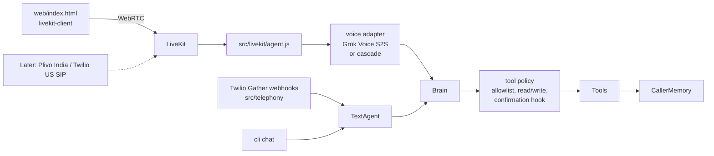

# Charlie-Agent

**A voice-first AI agent showcase** — talk to Charlie in the browser, keep the Twilio call webhooks, and take external actions (web search, HTTP requests, tool calls) through one shared brain.

> **Not affiliated with xAI.** Charlie-Agent is an independent open-source project inspired by publicly documented Grok / Grok Bot capabilities. It is not a product of xAI, does not use proprietary Grok Bot internals, and is not endorsed by xAI.

Built as a clean architecture demo for [sravan2828](https://github.com/sravan2828): minimal, runnable, well-commented **Node.js** (ESM). The text CLI and Twilio webhooks run on Node 18+. The LiveKit voice worker needs Node 20+.

---

## Vision

Charlie is the kind of agent you can **talk to** — in a browser now, and on the phone later — while it remembers facts about you and reaches the outside world through tools. The same high-level shape as modern Grok bots, but open, inspectable, and owned by you.

Core capabilities in this repo:

1. **Browser voice** — mic in, spoken answers out, via LiveKit and Grok Voice speech-to-speech.
2. **Shared brain** — tools, memory, system prompt, and tool policy. The text CLI, Twilio webhooks, and the voice worker all call it. The brain does not know whether a turn came from WebRTC, SIP, or Twilio.
3. **Twilio webhooks (kept)** — inbound Gather+Say and outbound REST calls still work.
4. **Text REPL** — exercise the brain without audio (`npm run chat`).

---

## Architecture



The voice adapter is the only piece that speaks Grok Voice (`wss://api.x.ai/v1/realtime`, model `grok-voice-latest`, through [`@livekit/agents-plugin-xai`](https://docs.livekit.io/agents/models/realtime/spacexai/)). Set `VOICE_STACK=cascade` to swap in LiveKit Inference STT + LLM + TTS without touching the brain. Phone calls are a new transport into the same LiveKit worker: [docs/sip-trunks.md](docs/sip-trunks.md).

**Twilio turn-taking today:** `<Gather input="speech">` → brain → `<Say>`. Those routes are unchanged.

---

## Design inspiration: Grok capabilities

Research snapshot as of **November 2026**, drawn only from public xAI documentation and product pages. Charlie-Agent mirrors the *ideas*; it does not reimplement proprietary Grok systems.

| Grok capability | What public docs say | Source | Charlie-Agent mapping |
| --- | --- | --- | --- |
| **Voice / speech-to-speech** | Realtime full-duplex voice agents with sub-second latency, tool use mid-conversation, interruption/barge-in; also TTS + STT APIs | [Speech to speech](https://docs.x.ai/developers/model-capabilities/audio/speech-to-speech), [Voice overview](https://docs.x.ai/developers/model-capabilities/audio/voice) | **Browser path** — LiveKit Agents + xAI Grok Voice realtime plugin (`grok-voice-latest`). Twilio Gather+Say remains for the phone webhook demo. |
| **Realtime conversation** | WebSocket realtime endpoint (`/v1/realtime`), session control for instructions/tools/voice | [Speech to speech](https://docs.x.ai/developers/model-capabilities/audio/speech-to-speech) | **Used by the voice worker.** The LiveKit xAI plugin owns the WebSocket. Tool calls are executed by the shared brain, not by xAI server-side tools. |
| **Tool use / function calling** | Custom functions (JSON Schema) + server-side built-ins; model requests a call, you execute, return results; parallel calls supported | [Tools overview](https://docs.x.ai/developers/tools/overview), [Function calling](https://docs.x.ai/developers/tools/function-calling) | **Implemented** — OpenAI-style tool schemas + dispatch loop in `src/agent.js`. |
| **Web search** | Built-in server-side `web_search` tool on the xAI API | [Tools overview](https://docs.x.ai/developers/tools/overview) | **Stubbed (default)** — labelled stub results; optional DuckDuckGo Instant Answer via `SEARCH_BACKEND=duckduckgo`. |
| **X search** | Built-in server-side `x_search` over posts/users/threads | [Tools overview](https://docs.x.ai/developers/tools/overview) | **Roadmap** — not wired; would be another tool schema. |
| **Image understanding** | Image input (`input_image` / URL or base64) alongside text; jpg/png, ≤20 MiB | [Image understanding](https://docs.x.ai/developers/model-capabilities/images/understanding) | **Roadmap** — text-only agent loop today. |
| **Memory** | Grok Bot remembers facts across chats for a personal bot; Responses API can store stateful conversations ~30 days | [Grok Bot chat docs](https://docs.x.ai/grok-bot/chat-and-collaboration), [Generate text / Responses](https://docs.x.ai/developers/model-capabilities/text/generate-text), [Grok Bot changelog](https://x.ai/changelog/bot) | **Implemented (simple)** — per-caller JSON files in `data/memory/` + `remember` tool. |
| **Multi-turn context** | Mix roles freely; continue via `previous_response_id` or local history | [Models](https://docs.x.ai/developers/models), [Generate text](https://docs.x.ai/developers/model-capabilities/text/generate-text) | **Implemented** — in-process message list per call / CLI session. |
| **Long context** | Grok 4.7 context window up to **500k** tokens (knowledge cutoff May 2026) | [Models](https://docs.x.ai/developers/models), [Grok 4.7 guide](https://docs.x.ai/developers/grok-4-7) | **Inherited** — whatever the configured model supports; no local compaction yet (**roadmap**). |
| **Reasoning** | Configurable reasoning levels on Grok 4.7; encrypted reasoning content on Responses API | [Grok 4.7 guide](https://docs.x.ai/developers/grok-4-7) | **Roadmap** — Chat Completions client today; Responses API + reasoning not wired. |
| **Code execution** | Built-in sandboxed `code_interpreter` / `code_execution` tool | [Tools overview](https://docs.x.ai/developers/tools/overview) | **Roadmap** — not included (intentionally out of scope for a phone showcase). |
| **Grok Bot voice chat** | Live spoken conversation with a bot on desktop/mobile; mute, transcript, continues work after hangup; draws on earlier calls/memory | [Message and collaborate](https://docs.x.ai/grok-bot/chat-and-collaboration), [Changelog](https://x.ai/changelog/bot) | **Mirrored in spirit** — phone gather loop + JSON memory; no native Grok Bot desktop integration. |

---

## Project layout

```
Charlie-Agent/
├── README.md
├── docs/sip-trunks.md      # later: Plivo India + Twilio US into LiveKit
├── web/index.html          # mic in, audio out, connect button
├── LICENSE                 # MIT © Sravan Kumar
├── package.json
├── .env.example            # placeholders only
├── .gitignore
├── src/
│   ├── index.js            # public exports
│   ├── cli.js              # serve | call | chat | token
│   ├── config.js           # dotenv-backed settings
│   ├── llm.js              # OpenAI-compatible fetch client
│   ├── agent.js            # text/Twilio loop, calls the brain
│   ├── memory.js           # per-caller JSON memory
│   ├── brain/              # tools, memory, policy, system prompt
│   ├── voice/              # Grok Voice adapter, cascade swap
│   ├── livekit/            # worker, token mint, participant id
│   ├── tools/
│   │   ├── registry.js     # schemas + dispatch
│   │   ├── webSearch.js    # stub | duckduckgo
│   │   └── httpRequest.js  # allowlisted HTTP
│   └── telephony/
│       ├── twilioServer.js # Express webhooks (kept)
│       └── outbound.js
├── data/memory/            # runtime memory (gitignored contents)
└── tests/                  # node:test, no network/credentials required
```

---

## Quickstart

Requires **Node.js 18+** (built-in `fetch`).

```bash
npm install

# Optional: configure LLM / Twilio
cp .env.example .env
# edit .env — set XAI_API_KEY to talk to api.x.ai (or any compatible base URL)

# Text REPL (works without a key; prints a clear offline message)
npm run chat
# or: node src/cli.js chat

# Run Twilio webhooks (pair with ngrok / cloudflare tunnel)
npm run serve
# or: node src/cli.js serve --port 8000

# Place an outbound call (needs real Twilio creds + PUBLIC_BASE_URL)
npm run call -- +15555550123

# Tests (offline, no API keys)
npm test
```

Point Twilio's voice webhook to `https://<your-tunnel>/voice/inbound` (POST).

### Talk to Charlie in the browser

You need **Node.js 20+** for this path (LiveKit Agents). The commands above still run on Node 18+.

1. Create a free project at [LiveKit Cloud](https://cloud.livekit.io/), or run a local server:

   ```bash
   # https://github.com/livekit/livekit  — dev mode prints a URL, key, and secret
   livekit-server --dev
   ```

2. Copy the URL, API key, and API secret into `.env` (`LIVEKIT_URL`, `LIVEKIT_API_KEY`, `LIVEKIT_API_SECRET`). Set `XAI_API_KEY` from [console.x.ai](https://console.x.ai/) so the worker can open the Grok Voice realtime WebSocket. Leave the secrets out of git.

3. In one terminal, start the voice worker (it registers as agent `charlie`):

   ```bash
   npm run voice
   # equivalent: node src/livekit/agent.js dev
   ```

   If you have the [LiveKit CLI](https://docs.livekit.io/agents/start/voice-ai/), `lk agent dev src/livekit/agent.js` is the same worker. `npm run voice` does not need the CLI. The worker prints a deprecation note for its built-in `dev` command; that command still connects and serves rooms.

4. In another terminal, start the token server and open the page:

   ```bash
   npm run token
   # http://127.0.0.1:8787
   ```

5. Click **Connect**, allow the microphone, and speak. Charlie's audio plays in the page. Transcripts show up when LiveKit forwards them.

`npm run token` binds to `127.0.0.1` on purpose. The page asks this process for a LiveKit access token; do not expose it on the public internet without authentication.

To try the cascade adapter instead of Grok Voice, set `VOICE_STACK=cascade` and use LiveKit Inference for STT, LLM, and TTS (billed via the LiveKit key, no xAI key required). The brain and the web page stay the same.

The page uses `livekit-client` directly so it does not need a bundler. A React client can switch to `@livekit/components-react` against the same `/token` endpoint. React Native can reuse that endpoint later with `@livekit/react-native`.

Phone calls through Plivo (India) or Twilio (US) SIP trunks are documented in [docs/sip-trunks.md](docs/sip-trunks.md) and are not implemented.

---

## Environment variables

| Variable | Purpose | Default |
| --- | --- | --- |
| `XAI_API_KEY` | Bearer token for the LLM endpoint | _(empty → graceful offline)_ |
| `LLM_BASE_URL` | OpenAI-compatible API root | `https://api.x.ai/v1` |
| `LLM_MODEL` | Model id | `grok-4.7` |
| `LLM_MAX_TOOL_ITERATIONS` | Cap on tool loops per turn | `6` |
| `TWILIO_ACCOUNT_SID` | Twilio account | placeholder |
| `TWILIO_AUTH_TOKEN` | Twilio auth token | placeholder |
| `TWILIO_PHONE_NUMBER` | Caller ID / from number | placeholder |
| `PUBLIC_BASE_URL` | Public URL Twilio can reach | `http://localhost:8000` |
| `SEARCH_BACKEND` | `stub` or `duckduckgo` | `stub` |
| `HTTP_ALLOWLIST` | Comma-separated hosts for `http_request` | `example.com,api.github.com` |
| `MEMORY_DIR` | Per-caller JSON directory | `./data/memory` |
| `LIVEKIT_URL` | LiveKit Cloud or local WebSocket URL | empty |
| `LIVEKIT_API_KEY` | LiveKit API key | empty |
| `LIVEKIT_API_SECRET` | LiveKit API secret | empty |
| `LIVEKIT_AGENT_NAME` | Worker name the token (and later SIP rules) dispatch | `charlie` |
| `LIVEKIT_TOKEN_TTL` | Access token lifetime (`1h`, `10m`, …) | `1h` |
| `TOKEN_HOST` / `TOKEN_PORT` | Token server bind address | `127.0.0.1:8787` |
| `XAI_VOICE_MODEL` | Grok Voice realtime model | `grok-voice-latest` |
| `XAI_VOICE` | Grok Voice id (`eve`, `ara`, `rex`, `sal`, `leo`) | `eve` |
| `VOICE_STACK` | `grok` (speech-to-speech) or `cascade` (STT+LLM+TTS) | `grok` |
| `CASCADE_STT_MODEL` / `CASCADE_LLM_MODEL` / `CASCADE_TTS_MODEL` / `CASCADE_TTS_VOICE` | Used only when `VOICE_STACK=cascade` | see `.env.example` |
| `TOOL_ALLOWLIST` | Tools the brain will run | `web_search,http_request,remember` |
| `TOOL_MODE` | `read` or `readwrite` | `readwrite` |
| `CONFIRM_TOOLS` | Extra tools that wait for `confirm_action` | empty |
| `VOICE_TOOL_ALLOWLIST` | Narrower allowlist for the voice worker only | empty (use `TOOL_ALLOWLIST`) |

**Never commit `.env` or real secrets.** `.gitignore` excludes them.

### Tool safety

The brain is the only thing that runs a tool.

- **Allowlist.** `TOOL_ALLOWLIST` is the set of tool names a session may call. Anything else returns an error. `VOICE_TOOL_ALLOWLIST`, when set, is what the voice worker passes in; the brain does not look at the transport to decide.
- **Read vs write.** `web_search` and `http_request` GET/HEAD are read. `remember` is write. `TOOL_MODE=read` refuses write tools.
- **Confirmation.** POST `http_request` (a send) and any name in `CONFIRM_TOOLS` return `needs_confirmation` and do not run. The model must call `confirm_action` afterwards. The default hook trusts only that boolean, not the transcript. Pass a `confirmHook` into `Brain` when you want an out-of-band owner approval that can still say no.
- **HTTP allowlist.** `HTTP_ALLOWLIST` is unchanged. Hosts outside it never get a request, and a POST to a blocked host is refused before a confirmation prompt.
- **Transcripts are data.** Speech and typed text are stored as notes. They cannot widen the allowlist or approve a send.

---

## Honest status & limitations

| Area | Status |
| --- | --- |
| Shared brain + tool policy | Works offline (covered by `npm test`) |
| Agent tool loop / text REPL | Works; degrades clearly without a key |
| Browser voice (LiveKit + Grok Voice) | Code complete; needs LiveKit credentials and `XAI_API_KEY` |
| Cascade voice swap (`VOICE_STACK=cascade`) | Wired; needs LiveKit Inference |
| Inbound / outbound Twilio Gather | Kept; needs your Twilio account + public URL |
| Plivo India / Twilio US SIP into LiveKit | Documented only (`docs/sip-trunks.md`) |
| Live web search | Stub by default; DuckDuckGo IA optional |
| X search / image / code exec / reasoning API | Roadmap |
| Auth of Twilio webhooks (signature validation) | Not implemented — add before exposing publicly |
| Token server authentication | Localhost only — add auth before exposing it |
| Multi-process session store | In-memory Map for Twilio; LiveKit rooms are separate |

This is a **showcase harness**, not a hardened production agent.

---

## Roadmap

- [x] Browser voice session on LiveKit with Grok Voice speech-to-speech
- [ ] Plivo India and Twilio US SIP trunks (see `docs/sip-trunks.md`)
- [ ] React Native client on the same token endpoint
- [ ] Optional xAI Responses API client (stateful `previous_response_id`, reasoning)
- [ ] Native `x_search` tool schema
- [ ] Image input path for MMS / uploaded photos
- [ ] Context compaction for long calls
- [ ] Twilio request signature validation
- [ ] Durable session store (Redis)

---

## License

MIT License — Copyright (c) 2026 Sravan Kumar. See [LICENSE](./LICENSE).
